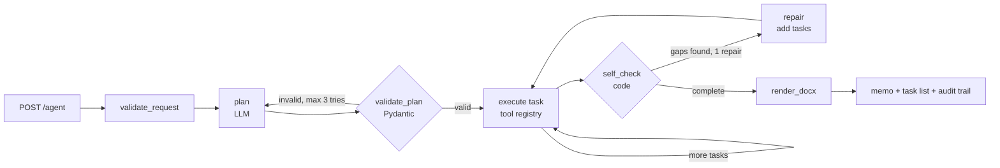

# credit-memo-agent

An autonomous agent that turns a loan analyst's plain-English request into an audit-ready
**credit memo (.docx)**. It plans its own tasks, fetches the borrower's data, computes the
ratios, checks them against credit policy, checks its own memo for gaps, and fixes them
before handing it to a credit officer.

**The rule it is built on: the LLM plans and writes; code calculates and decides.**
A credit decision never depends on a model doing arithmetic.

Python · LangGraph · FastAPI · Groq (gpt-oss-120b, free tier) · Pydantic · python-docx

## How it works



1. **Plan.** The LLM reads the request and returns a JSON plan: which data to fetch, what to
   compute, which sections to write, and the assumptions it is making about missing or
   conflicting information. An invalid plan (unknown tool, bad arguments) is sent back to
   the model with the validation error.
2. **Execute.** Each task calls a tool from a fixed allowlist. A failed task is recorded and
   the run continues.
3. **Self-check** (the engineering improvement). Code verifies the finished memo: all 5
   sections written, all ratios computed, every policy rule tested, and **every figure in
   the model's prose found in that section's source data, in ₹ crore**. Missing sections are
   added back as new tasks; a section with an invented figure is redrafted with the reason.
   This runs once, and anything still wrong is flagged in the memo.
4. **Render.** A Word memo with the recommendation, assumptions and open questions, the
   ratio and policy tables, a sign-off block for the credit officer, and the agent's full
   task log as an audit trail.

## Who does what

| Step | Done by | Why |
|---|---|---|
| Deciding what to fetch and write | LLM | Each request is different |
| Fetching borrower data | Code (tools) | Facts come from systems, not the model |
| DSCR, loan-to-value, debt/equity, current ratio, GST vs bank gap | **Code** | Arithmetic must be exact and testable |
| Policy pass/fail and the recommendation | **Code** | A lending decision must be explainable and auditable |
| Writing each memo section | LLM, from that section's facts only | Prose is the model's job; it may not introduce new numbers |
| Completeness and figure check | Code | The agent checks its own work before a human does |

## Demo scenarios

The borrowers and the credit policy are mock data in `app/mock_data.json`.

| Request | What the agent has to handle | Expected outcome |
|---|---|---|
| "Prepare a credit memo for Shree Ganesh Packaging's ₹2 crore working-capital loan." | Complete data | All 6 policy rules pass · DSCR 1.60 · **recommend approval** |
| "Draft a credit memo for Patel Agro's ₹5 crore term loan. We want it in committee this week. Their FY25 audited financials aren't in yet, and their GST turnover doesn't match their bank statements." | Missing financials, conflicting data, time pressure | Uses FY25 provisional figures and says so · flags an 18% GST vs bank gap · DSCR 1.08 below the 1.25 minimum · **refer to committee with conditions** |
| "Quick memo for Shree Ganesh, just the financials and a recommendation." | A plan that skips required sections | Self-check adds the 3 missing sections the memo template requires |

## Results on the live model

Run against Groq `openai/gpt-oss-120b` (fallback `gpt-oss-20b`). The memos are in [`samples/`](samples/).

| Scenario | What happened | LLM calls | Time |
|---|---|---|---|
| Standard | 11-task plan, all 6 rules pass, DSCR 1.60, **recommend approval** | 6 | ~6 s |
| Complex | Fetched FY24 as well because FY25 is provisional · 2 assumptions recorded · DSCR 1.08 and 18.1% GST gap fail · 2 open questions · **refer to committee** | 6 | ~7 s |
| Partial request | First plan rejected (no loan amount) and retried · plan wrote 2 of 5 sections · self-check added the other 3 | 7 | 12–40 s |

## Debugging insight

**Issue.** The first memos read well but were wrong: "$14.6 million" for ₹14.6 Cr, the ₹2.3 Cr
annual debt service called a coverage ratio, and loan-to-value 58.1% described as a policy
breach when it passes.

**Root cause.** The input, not the model. Facts had no units, keys like `debt_service_cr` were
ambiguous, and the Risk Assessment section never saw the policy results, so it guessed.

**Fix.** Self-explaining fact labels with units, the policy results passed to every analysis
section, and a figure check in the self-check that redrafts any section quoting a number that
isn't in its source data (`ungrounded` in `app/tools.py`, tested in `tests/test_graph.py`).

## Tradeoff: autonomous planning vs a deterministic workflow

A fixed pipeline is predictable but can't adapt: it would not have fetched FY24 for Patel Agro or
recorded how to treat provisional figures. A fully autonomous agent adapts, but a bank can't audit
a model choosing tools freely. So the split is: **the model decides what to do; code validates the
plan, does the maths, makes the decision and makes the repairs.** Some flexibility is given up for
runs that are repeatable and auditable.

## API

```http
POST /agent
{"request": "Draft a credit memo for Patel Agro's ₹5 crore term loan..."}
```

Returns the agent's task list (each task's tool, LLM or code, status and timing), the
assumptions, flags and open questions, the self-check result, the recommendation and a
`document_url`. `GET /documents/{run_id}` downloads the memo. Invalid input gets a 422; a
plan that is still invalid after 3 tries returns `status: "failed"` with the reason.

## Run it

```bash
uv sync
export GROQ_API_KEY=...
uv run uvicorn app.main:app --reload
# open http://localhost:8000 for the demo page, or http://localhost:8000/docs
uv run pytest
```

## Layout

```
app/
  graph.py         LangGraph state, nodes and edges
  schemas.py       Plan, Task, request and response models
  prompts.py       planning and section-writing prompts
  tools.py         tool functions and the allowlist registry
  ratios.py        ratio maths and policy checks (no LLM)
  docx_writer.py   Word memo
  main.py          FastAPI
  static/          demo page
samples/           memos from the three scenarios
tests/             ratio maths; the graph with a fake LLM (retry, repair, redraft, guardrail)
```

## Design decisions

- **LangGraph over a hand-written loop.** The retry, the task loop and the repair loop are
  explicit edges, so the control flow can be read straight from the graph. List-valued state
  (flags, task log) uses reducers, so each node appends to it instead of overwriting it.
- **Plan first, then execute,** instead of letting the model pick each next tool. A visible
  plan can be validated before anything runs, and it keeps runs predictable for audit.
- **One agent, not many.** The task is a single pipeline; extra agents would add
  coordination without solving a problem this task has.
- **For production:** a job queue with workers instead of a blocking request, LangGraph
  checkpoints in Postgres so a run can resume, object storage for the memos, filling the
  bank's own Word template, and a human-approval step inside the graph.
